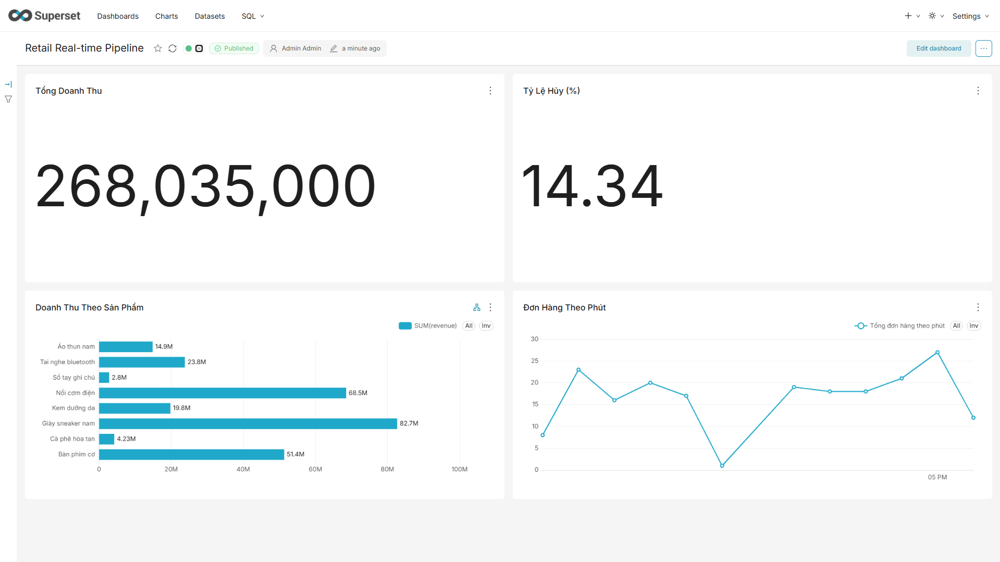
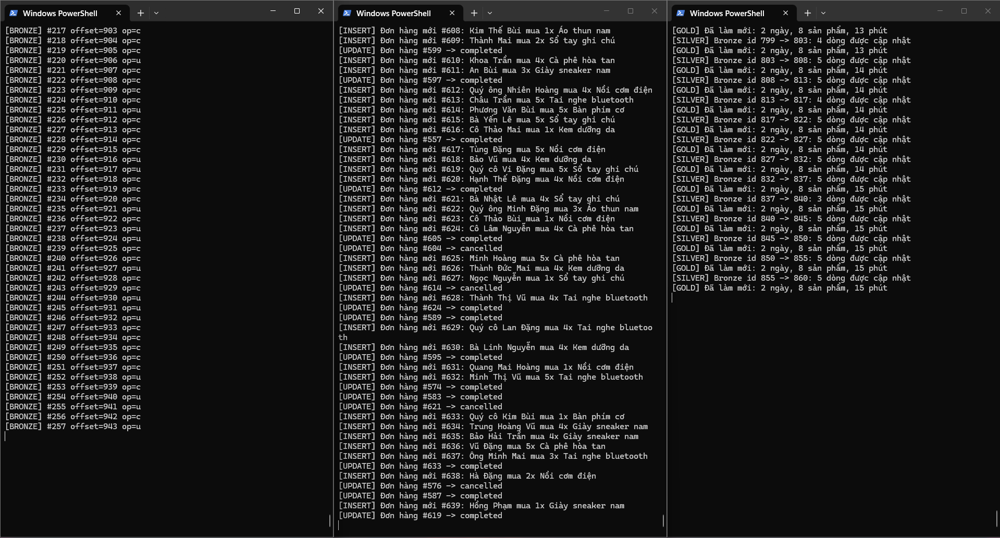
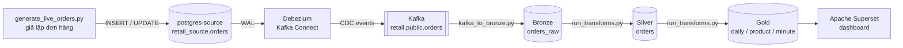

# Real-time Retail Data Pipeline

Pipeline dữ liệu thời gian thực mô phỏng luồng đơn hàng bán lẻ: bắt thay đổi từ database nguồn bằng **CDC (Debezium)**, truyền qua **Kafka**, xử lý theo **Medallion Architecture (Bronze → Silver → Gold)** trên PostgreSQL và hiển thị trên dashboard **Apache Superset** tự làm mới mỗi 10 giây.

> Dữ liệu là **synthetic** (script tự sinh), không phải dữ liệu thật của bất kỳ tổ chức nào.

## Demo





## Kiến trúc



| Tầng | Bảng | Vai trò |
|---|---|---|
| Bronze | `bronze.orders_raw` | Lưu nguyên trạng từng CDC event (JSONB), không biến đổi |
| Silver | `silver.orders` | Mỗi đơn hàng 1 dòng, luôn là trạng thái mới nhất; đã giải mã giá và thời gian |
| Gold | `gold.daily_sales`, `gold.product_sales`, `gold.minute_sales` | KPI cho dashboard: doanh thu, số đơn, tỷ lệ hủy theo ngày; xếp hạng doanh thu theo sản phẩm; đơn hàng theo phút (cửa sổ 60 phút) |

## Công nghệ

| Thành phần | Công nghệ |
|---|---|
| Hạ tầng | Docker Compose |
| Database | PostgreSQL 16 (nguồn bật logical replication, và warehouse) |
| Message broker | Apache Kafka 7.6 (Confluent) + Zookeeper |
| CDC | Debezium 2.7.3 (Kafka Connect, PostgresConnector, plugin `pgoutput`) |
| Xử lý | Python: `confluent-kafka`, `psycopg2`, `Faker` |
| Dashboard | Apache Superset (image tự dựng, thêm driver PostgreSQL) |

## Những điểm kỹ thuật đáng chú ý

- **CDC đầy đủ:** bảng nguồn đặt `REPLICA IDENTITY FULL` để UPDATE và DELETE mang theo cả giá trị cũ.
- **Bronze an toàn khi đọc lại:** offset Kafka chỉ được commit sau khi ghi DB thành công, và khóa duy nhất `(topic, partition, offset)` cùng `ON CONFLICT DO NOTHING` giúp đọc lại cùng một message không tạo dòng trùng.
- **Giải mã kiểu dữ liệu của Debezium:** `NUMERIC` được mã hóa thành chuỗi base64 (số nguyên big-endian chia 10^scale) và `TIMESTAMP` là micro giây từ epoch. Silver giải mã bằng hàm SQL `silver.decode_debezium_decimal` và `to_timestamp`.
- **Silver incremental:** dùng watermark theo id Bronze, `DISTINCT ON` chọn event mới nhất của từng đơn, upsert có điều kiện `last_kafka_offset` mới hơn (event cũ không đè event mới), và watermark được cập nhật cùng transaction với dữ liệu.
- **Gold:** doanh thu chỉ tính đơn `completed`; `cancel_rate = cancelled / (completed + cancelled)`; ngày và phút tính theo giờ Việt Nam (UTC+7); `minute_sales` là cửa sổ trượt 60 phút; mỗi lần làm mới nằm trong một transaction nên dashboard không bao giờ thấy bảng rỗng.

## Kiểm chứng số liệu

Một lần đối chiếu giữa các tầng:

- 137 completed + 18 cancelled + 164 pending = 319 đơn, bằng đúng số đơn trong Silver.
- Tổng doanh thu 8 sản phẩm = doanh thu theo ngày = 171.405.000.
- Doanh thu từng sản phẩm = đơn giá × số lượng bán (ví dụ giày sneaker nam: 780.000 × 74 = 57.720.000).
- Tỷ lệ hủy: 18 / (137 + 18) = 11,61%.

## Chạy thử

Yêu cầu: Docker Desktop, Python 3, PowerShell (Windows). Chạy trong thư mục project.

**1. Dựng hạ tầng**

```powershell
# Khóa bí mật cho Superset (tạo file .env, không commit file này)
$b = New-Object byte[] 32; [Security.Cryptography.RandomNumberGenerator]::Create().GetBytes($b); "SUPERSET_SECRET_KEY=" + [Convert]::ToBase64String($b) | Out-File -Encoding ascii .env

docker-compose up -d --build
```

**2. Tạo bảng nguồn và đăng ký Debezium** (đợi khoảng 30 giây cho `kafka-connect` khởi động)

```powershell
Get-Content .\create_source_schema.sql | docker exec -i postgres-source psql -U source_user -d retail_source
Invoke-RestMethod -Uri http://localhost:8083/connectors -Method Post -ContentType "application/json" -InFile "register-connector.json"
```

**3. Tạo các tầng trong warehouse**

```powershell
Get-Content .\create_warehouse_schema.sql | docker exec -i postgres-warehouse psql -U dw_user -d retail_warehouse
Get-Content .\create_silver.sql | docker exec -i postgres-warehouse psql -U dw_user -d retail_warehouse
Get-Content .\create_gold.sql | docker exec -i postgres-warehouse psql -U dw_user -d retail_warehouse
```

**4. Chạy pipeline** (mỗi lệnh trong một cửa sổ PowerShell riêng)

```powershell
pip install -r requirements.txt
python generate_live_orders.py
python kafka_to_bronze.py
python run_transforms.py
```

**5. Dựng dashboard Superset**

```powershell
docker exec superset superset db upgrade
docker exec superset superset fab create-admin --username admin --firstname Admin --lastname Admin --email admin@example.com --password admin
docker exec superset superset init
```

Mở http://localhost:8088 (tài khoản `admin` / `admin`), thêm database PostgreSQL với host `postgres-warehouse`, cổng `5432`, database `retail_warehouse`, user `dw_user`, password `dw_pass`. Tạo dataset từ ba bảng `gold.*` rồi dựng các chart: Big Number (tổng doanh thu, tỷ lệ hủy), Bar (doanh thu theo sản phẩm), Line (đơn hàng theo phút), và bật tự làm mới 10 giây.

> Mật khẩu trong code và tài liệu này chỉ dùng cho demo chạy local.

## Giới hạn đã biết

- Kafka mặc định giữ event 7 ngày, nên các đơn sinh ra từ lần chạy đầu (cách hơn 7 ngày) không còn trong Bronze và Silver. Hệ thống thật cần initial snapshot hoặc tăng thời gian lưu giữ.
- Kafka và Postgres chưa khai báo volume đặt tên: `docker-compose stop` rồi `start` giữ nguyên dữ liệu, nhưng `docker-compose down` sẽ mất dữ liệu.
- Silver và Gold chạy theo vòng lặp 10 giây (micro-batch), không phải streaming thuần.
- Script giả lập tạo nhiều đơn `pending` hơn thực tế, vì mô phỏng xử lý đơn hàng được làm đơn giản.

## Hướng phát triển

- Thêm initial snapshot, volume đặt tên và kiểm tra chất lượng dữ liệu (đối chiếu số dòng nguồn với Silver, cảnh báo khi lệch).
- Thay vòng lặp Python bằng công cụ điều phối (Airflow hoặc Dagster).
- Dùng Schema Registry + Avro, dbt cho Silver/Gold, ClickHouse cho tầng Gold.
- Export dashboard Superset vào repo để dựng lại tự động.
